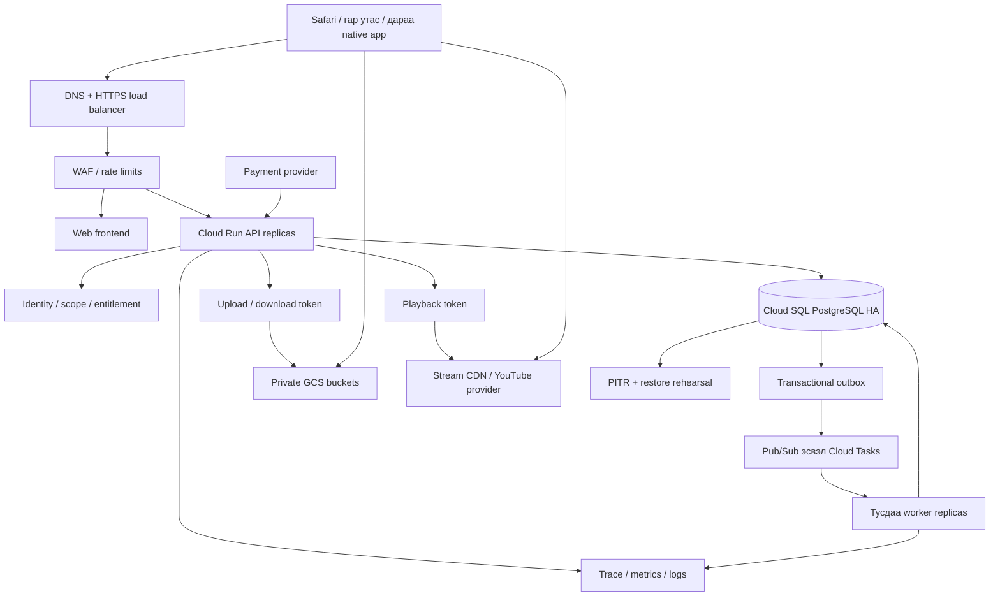

# Pi.mn · 5000 зэрэг шалгуулагчийн backend / infrastructure төлөвлөгөө

2026-09-22 · IF01–14, OP01–09. Архитектурын санал; үйлчилгээ үүсгээгүй, benchmark хийгээгүй. 5000 account ≠ 5000 зэрэг идэвхтэй exam session. Үнийн quote болон region сонголт хэмжилтийн дараа эцэслэнэ.

## 1. Байршуулалтын блокууд

| Блок | V1 санал / үүрэг | Өгөгдлийн эзэн, чухал хязгаар |
|---|---|---|
| DNS/HTTPS | `pi.mn`, шаардлагатай `api.pi.mn`; staging тусдаа | DNS admin access, certificate renewal, record rollback; бодит record одоо өөрчлөхгүй |
| Edge | HTTPS load balancer + Cloud Armor санал | API ingress шууд bypass болохгүй; сургууль нэг NAT IP-тайг бодолцсон account/session rate |
| Web | Одоогийн framework-ийн frontend, static asset cache | Нийтийн контент cache; private response-д public CDN cache хориглох |
| API | Cloud Run stateless modular monolith | V1-д microservice бүрд DB үүсгэхгүй; bounded modules/API contract |
| PostgreSQL | Cloud SQL regional HA санал | Users, IDs, membership, attempts, payment ledger, entitlement нь transactional source of truth |
| Async worker | Cloud Run worker/job, Pub/Sub **эсвэл** Cloud Tasks | Фото/PDF, grading aggregate, import, video webhook, reconciliation; нэг ажилд шаардлагагүй 2 queue давхарлахгүй |
| Object media | GCS private buckets: permanent, evidence, temporary | Бинар файл DB-д биш; DB-д object key/hash/size/status/purpose |
| Video | YouTube холбоос эсвэл Cloudflare Stream signed delivery | Master GCS archive + stream copy; видео API instance-оор дамжихгүй |
| Cache | Эхэнд CDN/read snapshot; Redis зөвхөн хэмжилтээр шаардлагатай бол | Redis унавал эрх/төлбөр/accepted answer алдагдахгүй; authoritative state биш |
| Ops | Secret Manager, metrics/logs/trace, backup policy | Dev/staging/prod тусдаа service identity ба өгөгдөл |

AWS S3 бол AWS-ийн нэр; Google-ийн object storage нь **Google Cloud Storage**. Монголд хурдан эсэхийг Seoul/Tokyo зэрэг candidate region дээр Монголын ISP/утасны сүлжээнээс p50/p95 upload/download хэмжиж сонгоно. DB/API үндсэндээ ижил region; “Google учраас бүх үед хурдан” гэж үзэхгүй. REST API нь өгөгдөл солилцох гэрээ; Java/OOP эсвэл Netflix-ийн microservice бүтцийг хуулснаар өндөр хүртээмж автоматаар үүсэхгүй.

## 2. Backend module ба data ownership

| Модуль | Үндсэн entities | Дүрэм |
|---|---|---|
| Identity | User, StudentProfile, StudentCodeAlias, ParentLink, StaffAssignment | Stable internal ID; alias өөрчилсөн ч FK түүх үлдэнэ |
| Academic | Subject, CurriculumVersion, Topic, Skill, Formula, Method | Хичээл тус бүр taxonomy; source provenance; prerequisite cycle шалгах |
| Content | BookVersion, TestVariant, QuestionVersion, Asset, Solution, VideoAsset | Published content immutable revision; permanent asset-д TTL байхгүй |
| Classroom | Class, Enrollment, LessonSession, Attendance, DepartureSummary, LessonBundle | Онол сонгох → test/homework draft; нийтэлсний дараа version snapshot |
| Homework | AssignmentItem, Submission, Evidence, Review, Annotation | Сурагчийн анхны correctness ба teacher completion тусдаа |
| Exams | ExamVersion, ExamItem, Attempt, AnswerRevision, ItemResult, TopicScore, RankingSnapshot | Server time/deadline; key private; replay/regrade audit |
| Commerce | ProductVersion, Invoice, ProviderPayment, LedgerEntry, Grant, Refund | Unique providerTransactionId; one invoice transition; balanced ledger |
| Admissions | Application, PlacementAttempt, Evidence, ContactTask, TrialDecision, ContractRecord | Evidence READY хүртэл complete биш; туршилтын дараа гэрээ |
| Group | Group, Membership, SharingConsent, GroupResultProjection | Owner scope ≠ staff role; internal center fields projection-д байхгүй |
| Operations | Outbox, JobReceipt, AuditEvent, SourceDocument, ImportBatch | Unique job identity, payload version, safe logs, exception review |

Module өөрийн transaction/write service-ээ эзэмшинэ. API service-ээс хүссэн хүснэгт рүү дур мэдэн бичдэг загвар биш. `Subject` нэмэхэд code enum-д math-only condition нэмж явахгүй. Inheritance хэрэгтэй UI/entity төрөлд interface/composition хэрэглэнэ; сурагч нэг зэрэг номын эрх + танхимын enrollment + бүлгийн membership-тэй байж болно.

Index санал: `(attemptId, questionVersionId)` current answer unique; revision `(attemptId, questionVersionId, sequence)` unique; `(examId,status)` attempt; `(classId,sessionDate)` lesson; `(studentId,createdAt)` history; `(provider,providerTransactionId)` unique; `(invoiceId,grantType,scopeId)` fulfillment unique; outbox `(status,nextRunAt)`. Partition/replica нэмэхийг actual query plan ба хэмжээний дараа шийднэ. Money integer minor units/төгрөг; float ашиглахгүй.

## 3. API гэрээний эхний inventory

Эдгээр route нь санал; одоогийн кодод хэрэгжсэн endpoint гэж үзэхгүй. OpenAPI-д DTO, error, permission, idempotency, version бичих ажил OP03.

| Action / санал route | Хэн / шалгах хүрээ | Commit ба алдааны дүрэм |
|---|---|---|
| `GET /v1/me/dashboard` | Account, enrollment/parent scope | Safe projection; `updatedAt`, partial unavailable state |
| `POST /v1/lesson-bundles` | Өөрийн ангийн Багш+ | Idempotency-Key; онол/test/homework нэг суурийн draft |
| `PATCH /v1/lesson-sessions/:id/attendance` | Class staff | Version/If-Match; conflict бол шинэ утга харуулна |
| `PATCH /v1/lesson-sessions/:id/departure` | Class staff | Actor/time/audit; approximate vs individual actual ялгаатай |
| `POST /v1/uploads` | Purpose+owner+quota | Signed destination, max size/type/checksum, expiry; malicious mime шалгах |
| `POST /v1/uploads/:id/complete` | Upload owner | Object existence/size/hash verify → scan/processing job; fake complete боломжгүй |
| `POST /v1/submissions` | Assignment сурагч | Evidence READY requirement; request replay same receipt |
| `PUT /v1/reviews/:submissionId` | Assigned reviewer | Optimistic lock; teacher grade revision+annotation |
| `POST /v1/exams/:id/attempts` | Exam grant эсвэл placement audience | One active attempt policy; immutable exam snapshot, server start/deadline |
| `PUT /v1/attempts/:id/answers/:itemId` | Attempt owner; exam member item | Sequence+version, validation; committed receipt `savedAt`, no future answer key |
| `POST /v1/attempts/:id/submit` | Attempt owner/system deadline | Atomic freeze; repeat returns same receipt; score may pending |
| `GET /v1/attempts/:id/result` | Owner/scoped parent/group | Release policy; private key/feedback blocked until release |
| `POST /v1/orders` | Buyer | Price/product snapshot; provider invoice external ID persisted |
| `POST /v1/payments/:provider/callback` | Provider verification | Signature/auth+server verify where provider supports; amount/currency/merchant match |
| `GET /v1/orders/:id` | Order owner | Pending poll safe; cannot mark paid via GET alone |
| `POST /v1/videos/:id/playback-token` | Content entitlement+solution policy | Short expiry; no public master key; denied state |
| `POST /v1/groups` / `POST /v1/groups/:id/join` | Self-service user/member consent | Scope creation; no Pi staff upgrade |
| `POST /v1/admissions/:id/complete` | Applicant | Answers + ready PDF; review queue; no auto contract/debt |

Structured error: `{code, message, requestId, retryable, fieldErrors?}`. 401 refresh/login, 403 scope, 409 version conflict, 422 invalid input, 429 retry-after, 503 temporary state; UI нь “хадгалсан” гэж 200 response ч commit болоогүй үед хэлэхгүй. RequestId-г support харна; token/phone/raw answer-ийг error string-д хийхгүй.

## 4. Autosave → submit → score-ийн нарийн гэрээ

1. Client өөрчлөгдсөн answer-аа local pending queue-д version/sequence-тэй хадгална; зөвхөн хамгийн сүүлийн local answer-г нэгтгэж болох ч server receipt иртэл unsaved төлөвтэй.
2. API ownership, exam item membership, start/deadline, sequence шалгана. Серверийн цаг үндсэн. Server timestamp-ээр авсан хуучин request-д fairness grace байх эсэхийг урьдчилан policy болгон зарлана.
3. Transaction `AnswerRevision` ба current pointer шинэчилж commit хийгээд receipt өгнө. Ижил key/өөр payload conflict; хоцорсон sequence шинэ хариуг дарж болохгүй.
4. Client receipt дараа pending clear. Offline/reconnect-д дараалалтай retry/backoff+jitter; heartbeat бүрд бүх 40 бодлогыг дахин бичихгүй.
5. Submit өөрийн committed answers snapshot-ийг freeze, outbox event-ийг **нэг DB transaction**-д үүсгэнэ. Client pending answers байвал flush/status тайлбартай. Deadline worker үлдсэн attempt-ийг idempotent freeze.
6. Outbox dispatcher queue-д publish; queue тасарвал outbox үлдэнэ. Worker давтан delivery-г `jobKey+version`-ээр dedupe, grade snapshot-ийг нэг удаа commit.
7. Parent/student result pending → ready. Ranking batch/snapshot after cutoff; pending count ба updatedAt. Individual result гарахыг бүх ranking дуусахтай хамааралтай болгохгүй.

Албан live шалгалтанд DB outage-аас шалтгаалсан grace/reschedule нөхцөл, incident decision role урьдчилан тодорхой. Local pending нь server-confirmed answer биш. Redis lock дангаар эцсийн submit/credit correctness хамгаалахгүй.

## 5. Upload ба контентын амьдралын мөчлөг

Photo→PDF нь дангаараа хэмжээг бууруулахгүй: эхлээд EXIF orientation normalize, уншигдах crop/resize/compression, thumbnail; дараа PDF page bundling. Унших чанарын representative notebook test: харандаа, бүдэг гэрэл, жижиг томьёо, landscape. Original түр хадгалах хугацаа ба delete job ил тод. PDF/page rotate, zoom, normalized координат annotation; display rotation хадгалсан annotation-д зөв хувиргалт хийнэ.

Homework/makeup evidence-д 30хоног эсвэл сүүлийн10хичээлийн policy + unreviewed/dispute hold; permanent question/image/theory/video/LaTeX assets-д **TTL байхгүй**. Placement evidence өөр retention decision-тэй. Signed download endpoint бүх owner/class scope-ийг шалгана. Object tombstone + deletion audit; дүн/metadata үлдэнэ; backup/soft delete billable байж болно. Legacy object key-г homework prefix гэж таамгаар бөөнөөр устгахгүй.

Video master archive checksum+manifest, provider copy processing READY, publish mapping. Video CDN delivery болон GCS master backup тусдаа; browser-д raw bucket directory list өгөхгүй. Provider retention rule-ээс “хэзээ ч устахгүй” баталгаа гаргахгүй; хоёр хуулбар, restore test шаардлагатай.

## 6. Network, domain, secrets

- DNS: registrar/DNS owner, MFA, domain renewal calendar, A/CNAME records inventory. Deploy-ийн өмнө current records snapshot, TTL/rollback plan. DNS нь DB failover орлуулагч биш.
- HTTPS: managed certificate, TLS-only; redirect; API same-origin reverse route эсвэл зөв CORS allowlist. CORS нь authorization/firewall биш.
- API ingress: approved LB → API only. Cloud Run direct URL bypass-ийг provider ingress/IAM тохиргоогоор хаах; staging public crawl disabled/auth.
- DB: public network exposure-гүй private connectivity, зөвхөн API/worker service identity; migrations тусдаа эрх. PostgreSQL5432-ыг интернет рүү нээхгүй.
- Buckets: public access prevention, service-account minimal permissions; user-facing signed upload/download, upload purpose/quota/type/size; bucket CORS зөвхөн шаардлагатай origin/method.
- Credentials: Secret Manager-д provider API key, DB secret шаардлагатай бол; rotation/runbook. Browser-д bank secret болон service-account JSON байхгүй.
- WAF: per-user/session + endpoint-specific limits; exam center shared NAT-ийг ганц IP throttle-оор бүхлээр нь хаахгүй. Provider webhook source verification; allowlisted IP дангаар төгс баталгаа биш.
- Logs: pseudonymous IDs, trace correlation; raw passwords/tokens/phone/photo bytes/full answers үгүй. Admin audit ба request log retention өөр.

## 7. 5000 concurrency тооцооны суурь

| Workload таамаг | Тооцоо | Шалгах зүйл |
|---|---:|---|
| 5000 хүн 10 секунд тутам save | 500 request/sec | Jitterгүй burst болон steady хоёул |
| 5000 хүн 30 секунд тутам save | 166.7 request/sec | Deadline эрсдэл/UX; interval дараа сонгоно |
| 5000 start/login 60сек дотор | 83.3 request/sec | Password/auth latency + content reads нэмэлт |
| Бүх submit 10сек дотор | 500 request/sec | Freeze transaction, queue lag |
| 40 бодлого ×5000 attempt | 200,000 item result | Partial-credit rubric + snapshot aggregate |
| Save payload 2KB ×500rps | Ойролцоогоор 1MB/sec | TLS/header/log/index/replication ороогүй |
| Видео 5000×2Mbps | 10Gbps | CDN/provider, API bandwidth биш |

500rps дээр API хүсэлт 0.2сек үргэлжилбэл Little’s law-р ойролцоогоор100 in-flight; database lock/queue latency өсөхөд энэ тоо өснө. Default Cloud Run concurrency-г blindly ашиглахгүй: 1–2vCPU/1–2GiB зэрэг **benchmark-ийн эхний candidate** сонгож, active concurrency16/32 зэрэг туршилтаар CPU/memory/DB хязгаар хэмжинэ. [Cloud Run concurrency](https://docs.cloud.google.com/run/docs/about-concurrency).

Connection worksheet-ийн **жишээ**, бодит tier-ийн limit биш: DB budget200; reserve40; workers20; API remaining140 → max20instances×pool7=140. Migration/ops reserve-даа багтана. Бодит budget-ийг `max_connections`, RAM, query cost-аар шалгана. Connection proxy ашигласан ч бүх query capacity автоматаар нэмэгдэхгүй. Max instances, min warm instances, worker concurrency зэрэг нь нэг budget-тай; live эхлэхээс өмнө warm-up. Video/PDF worker-ийг exam API autoscaling-тэй холихгүй.

Тестийн profile: read/write/payment/video launch зэрэг normal workload + 2×богино spike; production-like representative data, test IDs, sandbox provider. 100 →1000 →5000 session, warm/cold; low-end mobile/4G reconnect, duplicate/out-of-order, start/submit herd. Load generator өөрөө bottleneck биш эсэхийг хянана.

## 8. Go-live SLO ба failure rehearsal

Төслийн эхний **зорилтот** босго: warm normal autosave p95<1сек, submit acknowledgement p95<2сек, non-business5xx<0.1% live interval; committed receipt өгсөн answer loss=0; duplicate payment/grant=0. Latency threshold-г тайлан/UX-ээр батална; өнөөдөр хангагдсан гэсэн үг биш. Grading/result p95 ба ranking publish lag-г rubric/provider/ачааллын дараа тусдаа тогтооно. 99.9% сарын availability санал≈43.8мин/сар downtime budget; “хэзээ ч унахгүй” баталгаа биш.

| Failure | Хүлээх ажиллагаа | Хэмжих/сэргээх нотолгоо |
|---|---|---|
| API instance унах | Replica retry, idempotent receipt | Duplicate write0, client unsaved харагдана |
| DB HA failover | Түр write outage, reconnect/backoff | Accepted answer replay + reconciliation; шинэ save-д худал success өгөхгүй |
| Queue/worker унах | Submit committed, outbox waiting | Recovery job дүн нэг удаа гаргана |
| Payment callback алдагдах | Server poll/reconcile pending | Зөв төлбөрийн grant manual approval-гүй нөхөгдөнө |
| Object processing унах | Upload retained/pending/retry | Application submit дутуу байдлыг тайлбарлана |
| Video provider унах | Player retry/fallback message | Тест/ирц API бие даан ажиллана |
| Cache унах | DB/read snapshot fallback, bounded load | Cache нь payment/attempt source of truth биш |
| Бүх region outage | Incident gate, restore/secondary strategy | Regional HA нь region loss-ийг бүрэн шийдэхгүй |

[Cloud SQL HA](https://docs.cloud.google.com/sql/docs/postgres/high-availability) нь failover үеийн connection тасалдлыг арилгахгүй. PITR ба backup configured, **restore rehearsal** шинэ isolated instance-д; record counts+ledger balances+sample attempts+assets check. Backup хийсэн log ганцаараа restore болсон баталгаа биш.

Санал RPO/RTO: regional disaster-ийн recovery point≤5мин, restore≤60мин гэдгийг зорилт болгон туршина; provider backup/binlog боломж, data size, cross-region copy frequency батлагдахаас өмнө амлахгүй. Same-region HA committed write хамгаалалт болон regional disaster RPO тусдаа. 5000 live яг outage үед exam pause/extension/reschedule шийдэх эзэн, хэрэглэгчийн status page, fairness log хэрэгтэй. Cross-region active-active DB-г V1-д шууд нэмэхгүй; хэмжсэн RTO шаардлагаар cost/consistency tradeoff шийднэ.

## 9. Deploy, observability, засвар

Pipeline: lint/typecheck → domain/unit tests → permission/DTO contract → content render QA → staging sandbox payment → load/failure report → backup readiness → expand-compatible migration → canary/traffic ramp → smoke → monitor. Schema contract үед хуучин API/worker ажиллах; destructive column drop дараагийн release. Rollback image digest/config/DB compatibility баримттай. Repair: dry-runaffected IDs, reviewer, transaction, audit, reconciliation; дүн/санхүүг түүхгүй SQL overwrite хийхгүй.

Dashboard: request latency/error, save receipt age, submit backlog, oldest outbox, payment pending age, failed processing, DB active connections/locks/CPU, replica/backup status, storage growth, video minute usage. Alert нь owner role+runbook link+examId/requestId-тай. Incident: илрүүлэх → эрсдэлийг хязгаарлах → хэрэглэгчийн төлөв шинэчлэх → сэргээх → reconciliation → root-cause fix. Багш report issue-д screenshot зөвшөөрсөн тохиолдолд, safe requestId, screenId/questionId өгнө.

## 10. Зардлын worksheet ба release дараалал

Сарын нийт = frontend/API compute + SQL primary/HA/storage/backup + workers/queue + LB/WAF + logs + object storage/egress + video minutes/master archive + domain/төлбөрийн шимтгэл. [Фото тооцоо](STORAGE-COSTS.md), [видео минутын жишээ](SYSTEM-DESIGN-V4-RESEARCH.md) нь нийт backend bill биш. Cloud SQL tier, min instances, workload hours тодорхойгүй тул яг нийт сарын үнэ зохиогоогүй.

Дараалал: (1) domain/API/schema contract →(2) 100x100/200x200 content QA+IDs →(3) auth/scope + classroom/homework pilot →(4) placement/parent/group →(5) payment sandbox automatic fulfillment →(6) exam grading/taxonomy/video pilot →(7) migrations/restore/failure tests →(8)5000 rehearsal →(9) scope freeze/launch. V1-д SMS/AI/ML/online-class code paths/jobs идэвхжүүлэхгүй. Блок бүрийн нарийн acceptance нь [backlog](SYSTEM-DESIGN-BACKLOG.md)-д байна.
