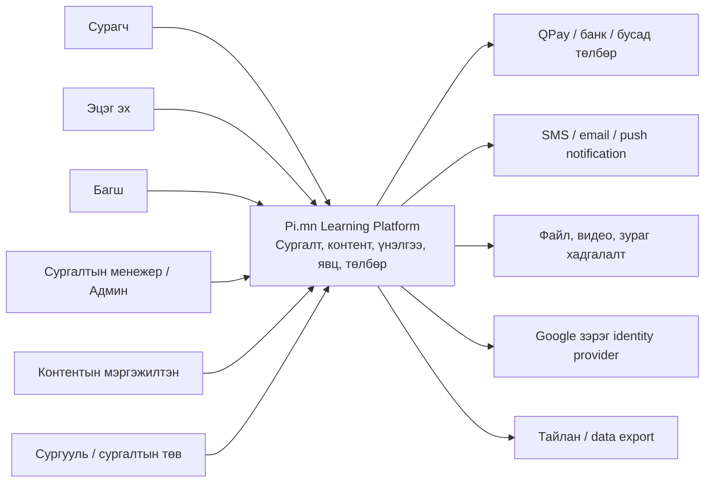
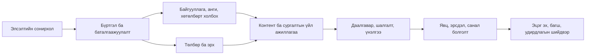
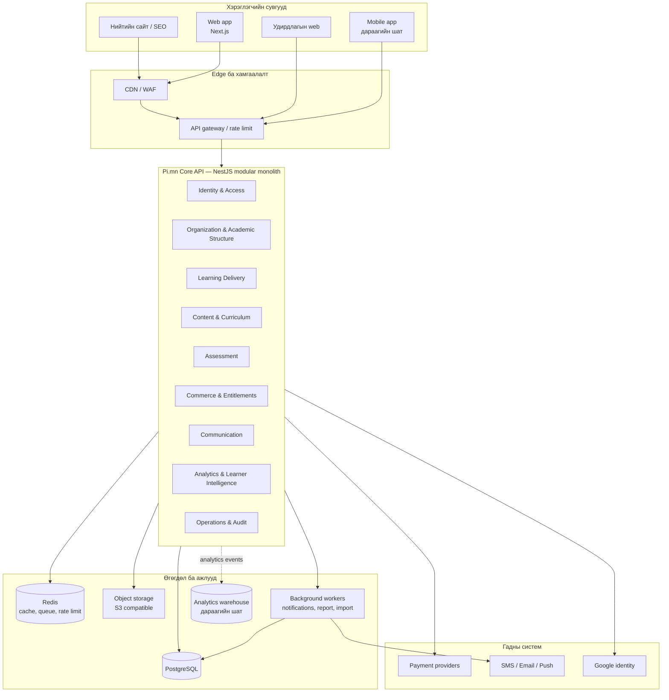
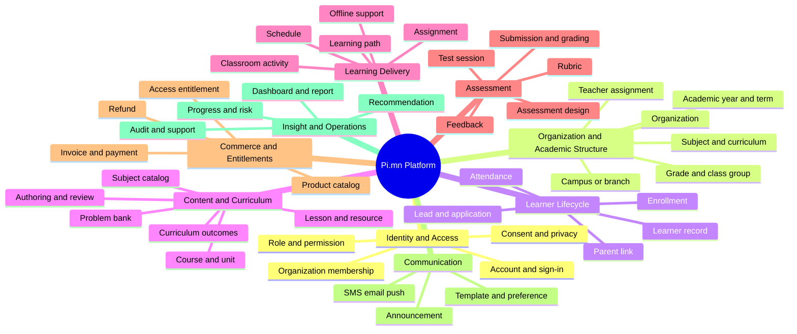
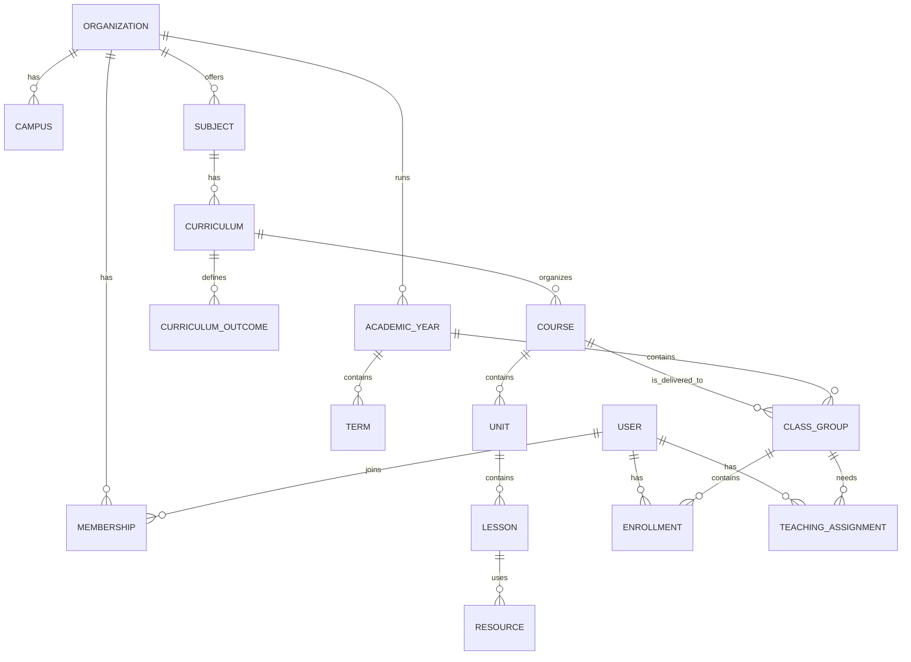
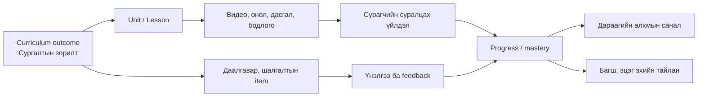
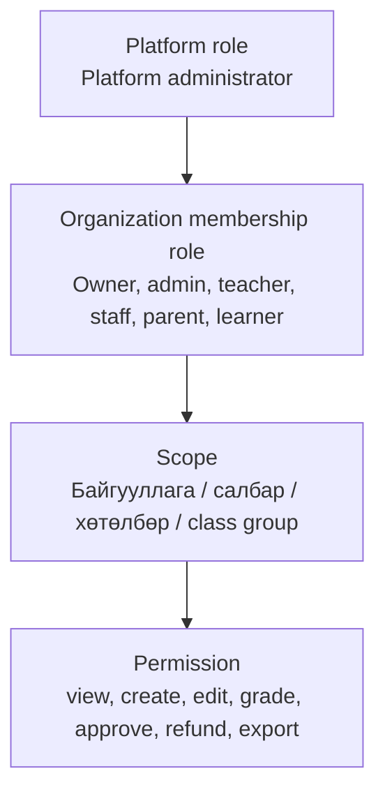
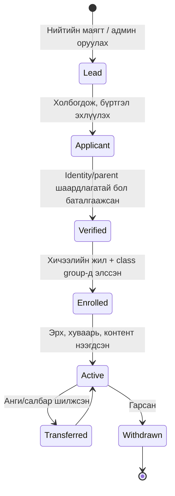
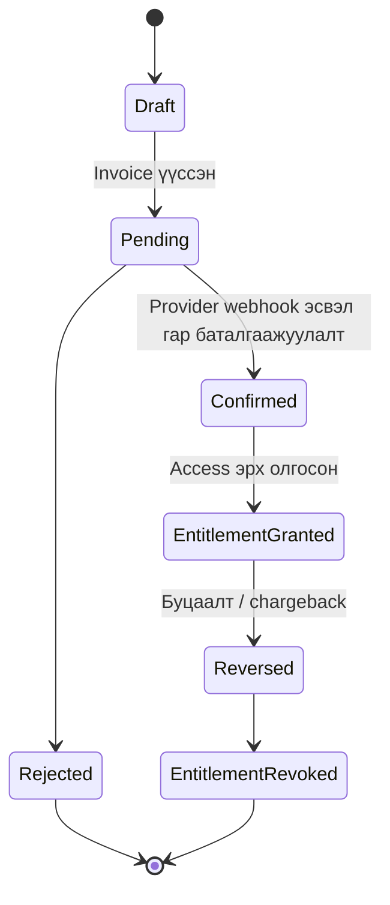

# Pi.mn — системийн дизайны суурь

> **2026-09-22 · v0.4 шинэчлэл:** Одоогийн зураглал `SYSTEM-DESIGN.html`, ажлууд `SYSTEM-DESIGN-BACKLOG.md`, медиа тооцоо `STORAGE-COSTS.md`, эх материалын шинжилгээ `SYSTEM-DESIGN-SOURCE-REVIEW.md`, төлбөрийн судалгаа `PAYMENT-RESEARCH.md`-д байна. Шинэ release scope/БҮТ/видео/элсэлтийн шийдвэр `SYSTEM-DESIGN-V4-RESEARCH.md`, дэд бүтэц `INFRASTRUCTURE-5000-PLAN.md`, дэлгэцүүд `UI-UX-REGISTER.md`-д байна. Доорх v0.1 бол архитектурын хэлэлцүүлгийн эхлэл: олон байгууллага, технологийн сонголт, хугацаа, эрхийн дүрэм нь батлагдсан шийдвэр биш. Одоогийн кодын бүх функцийг аудит хийсэн гэсэн үг биш. Зөрвөл v0.4-ийн ялгасан шаардлага/санал/шийдэх төлөвийг баримтална.

**Төлөв:** хэлэлцүүлгийн эхний хувилбар (v0.1)  
**Зорилго:** Одоогийн Pi.mn-ийг зөвхөн ЭЕШ-ийн математик бэлтгэлийн сайт биш, Монголын ерөнхий боловсролын олон хичээл, олон байгууллага, вэб болон гар утасны аппд тэлэх сургалтын платформ болгох архитектурын суурийг тодорхойлох.

Энэ баримт нь кодын ажлын жагсаалт биш. Эхлээд систем ямар асуудал шийдэх, ямар хэсгүүдээс бүрдэх, өгөгдөл хэний эзэмшилд байх, аль хэсэг ямар үүрэгтэйг нэг мөр ойлгодог болгоно. Үүний дараа л UX, Figma, API, database migration, хөгжүүлэлтийн таскууд гарна.

---

## 1. Одоогийн бодит байдал

Одоогийн систем нь **Next.js web + NestJS API + PostgreSQL/Prisma** гэсэн modular monolith бүтэцтэй. Энэ нь эхний өсөлтөд тохирсон зөв сонголт: нэг deploy, нэг database, модуль тус бүрийн код тусдаа.

Гэхдээ систем одоогоор нэг сургалтын төв, цөөн хичээлийн ойлголтоор бичигдсэн байна.

| Одоогийн ойлголт | Одоогийн хэлбэр | Өсөхөд үүсэх асуудал |
|---|---|---|
| Хичээл | `Subject` enum: `MATH`, `SOCIAL_STUDIES`, `SAT` | Шинэ хичээл бүр код, database migration, UI өөрчлөлт шаардана |
| Сурагч | `User` дээр role, нэвтрэлт, сурагчийн профайл хамт | Нэг хүн хэд хэдэн сургууль/төв, эсвэл багш ба эцэг эхийн олон үүрэгтэй байхыг муу илэрхийлнэ |
| Байгууллага | Нэг Pi.mn төв гэж далд ойлгогдсон | Олон сургууль, салбар, төвийг найдвартай тусгаарлаж чадахгүй |
| Сургалтын бүтэц | Ном → бүлэг → бодлого | Сургуулийн хөтөлбөр, улирал, анги, хичээлийн зорилттой уянгаар холбогдохгүй |
| Эрх | Нэг `User.role` | Байгууллага/анги/хичээлээс хамаарсан эрхийн хил дутна |

Эдгээр нь алдаа биш, эхний хувилбарын хязгаар. Харин цаашдын архитектурын ажил нь тэдгээрийг аюулгүй, үе шаттайгаар ерөнхий болгох юм.

---

## 2. Эхлээд зурах ёстой зургууд

Нэг л “system diagram” бүхнийг ойлгуулдаггүй. Том бүтээгдэхүүний хувьд дараах зургуудыг нэг дарааллаар гаргана.

| Зураг | Юуг хариулдаг вэ | Хэн ашиглах вэ |
|---|---|---|
| **System context (C4 L1)** | Pi.mn-ийг хэн, ямар гадны системтэй ашигладаг вэ? | Эзэн, бүтээгдэхүүний баг |
| **Container diagram (C4 L2)** | Web, mobile, API, database, файл, төлбөр, мэдэгдэл яаж холбогдох вэ? | Техникийн баг |
| **Capability map** | Систем юу хийж чаддаг вэ? Feature-үүд хаана хамаарах вэ? | Бүтээгдэхүүн, үйл ажиллагааны баг |
| **Domain map / bounded contexts** | Аль мэдээлэл, дүрэм аль модулийн эзэмшил вэ? | Backend баг |
| **User journey / BPMN flow** | Тухайн хүн алхам бүрт юу хийж, систем юу хариулах вэ? | UX, үйл ажиллагааны баг |
| **State machine** | Төлбөр, элсэлт, шалгалт, даалгавар зэрэг төлөв хэрхэн шилжих вэ? | Backend, QA |
| **ERD / data model** | Ямар entity хоорондоо ямар холбоотой вэ? | Backend, data баг |
| **Screen map** | Ямар role ямар дэлгэцээр ямар capability ашиглах вэ? | Figma, frontend баг |
| **Deployment diagram** | Production орчинд аюулгүй, найдвартай яаж ажиллах вэ? | DevOps, owner |

Эдгээр нь тусдаа боловч нэг эх сурвалжтай байх ёстой. Доорх нь эхний дөрвөн зургийн суурь юм.

---

## 3. Алсын харааны system context



Pi.mn-ийн үндсэн бүтээгдэхүүн нь “онлайн хичээл” дангаараа биш. Энэ нь **суралцагчийн амьдралын мөчлөгийг** удирддаг платформ байна:



---

## 4. Зорилтот container architecture

Эхний 2–3 жилд **modular monolith** хэвээр явна. Микросервис рүү эрт задрах нь feature-үүдийг улам тарамдуулж, хурдыг бууруулна. Харин домэйнүүдийн хил, API contract, event-ийг одооноос зөв тогтооно. Тодорхой хэсэг өндөр ачаалалтай болоход л тусдаа service болгоно.



### Container-ийн шийдвэрүүд

| Блок | Хариуцлага | Эхний шатны шийдвэр |
|---|---|---|
| Web | Сурагч, багш, админы browser хэрэглээ | Next.js-ийг үргэлжлүүлнэ |
| Mobile | Push, offline-first суралцах, камер, хурдан давтлага | Web-ийн API contract тогтсоны дараа тусдаа app |
| Core API | Бизнес дүрэм, permission, transaction, API | NestJS modular monolith хэвээр |
| PostgreSQL | Operational source of truth | Хамгийн чухал өгөгдөл энд байна |
| Object storage | Видео, PDF, зураг, attachment | Локал disk-ээс S3-compatible storage руу |
| Redis + worker | Queue, cache, scheduled job, notification | Шалгалтын hot path-ийг database-ээс хамгаална |
| Analytics warehouse | Том хэмжээний event/report query | Operational database-ээс тусад нь, зөвхөн хэрэгцээ өсөхөд |

---

## 5. Capability map — feature хаана амьдрах вэ?

Энэ зураг нь цаашид “энэ feature-ийг хаана хийх вэ?” гэсэн эргэлзээг арилгах гол зураг болно.



### Блок бүрийн эзэн ба хийх ажил

| Домэйн блок | Хэн голчлон ашиглах вэ | Юу хийдэг вэ | Одоогийн Pi.mn-тэй холбоо |
|---|---|---|---|
| Identity & Access | Бүх хүн, админ | Нэвтрэх, account холбох, permission, session | `auth`, `users`, Google login |
| Organization & Academic Structure | Админ, сургалтын менежер | Байгууллага, салбар, хичээлийн жил, анги, багшийн хуваарилалт | Одоогоор classroom/schedule хэсэгчилсэн |
| Learner Lifecycle | Менежер, багш, эцэг эх | Лийд, элсэлт, профайл, анги солилт, эцэг эхийн холбоо | `leads`, `classrooms`, `parents` |
| Content & Curriculum | Контент баг, багш+ | Хичээл, хөтөлбөр, unit, lesson, бодлого, видео, review | `content`, `lessons`, `videos`, `classification` |
| Learning Delivery | Сурагч, багш | Хуваарь, хичээл, даалгавар, суралцах урсгал | `schedule`, `assignments`, `attendance` |
| Assessment | Багш, сурагч | Тест зохиох, өгөх, үнэлэх, feedback | `tests`, `attempts`, `class-sessions` |
| Commerce & Entitlements | Худалдан авагч, админ | Үнэ, нэхэмжлэх, QPay, буцаалт, нэвтрэх эрх | `payments`, `passes`, `store`, `tuition` |
| Communication | Админ, багш | Зарлал, SMS, email, push, давтамжийн сонголт | `announcements`, `notifications` |
| Insight & Operations | Багш, удирдлага | Явц, эрсдэл, зөвлөмж, аудит, тайлан | `analytics`, `insights`, `events`, `audit` |

**Дүрэм:** шинэ feature эхлээд эдгээрээс аль capability-д хамаарахоо сонгоно. Нэг feature хоёр блокт хамаарвал нэг нь эзэн, нөгөө нь API/event хэрэглэгч байна. Ингэснээр controller, database table, UI хаа сайгүй давхардахгүй.

---

## 6. Бүх хичээл нэмэхэд шаардлагатай академик data model

Одоогийн `Subject` enum-ийг шууд олон газар үржүүлэхгүй. Хичээл нь database-д удирдагддаг entity болно.



### Гол entity-үүдийн утга

| Entity | Юу вэ | Яагаад хэрэгтэй вэ |
|---|---|---|
| `Organization` | Pi.mn ашиглаж буй сургууль, төв, хожим БШУЯ түвшний байгууллага | Tenant/data boundary. Нэг байгууллагын дата нөгөөд харагдахгүй |
| `Campus` | Салбар, байршил | Нэг төв олон салбартай болоход |
| `Membership` | Нэг user тухайн байгууллагад ямар үүрэг, эрхтэйг хадгална | Нэг хүн багш, эцэг эх, админ зэрэг үүрэгтэй байж болно |
| `AcademicYear`, `Term` | 2026–2027 он, I/II улирал | Дүн, анги, хөтөлбөр жилээр зөв тусгаарлагдана |
| `Subject` | Математик, Монгол хэл, Англи хэл, Физик гэх мэт admin удирддаг каталог | Шинэ хичээлд code deploy хийхгүй |
| `Curriculum` | Тухайн анги/хичээлийн албан эсвэл дотоод хөтөлбөрийн хувилбар | 2027 онд хөтөлбөр солигдсон ч хуучин сурагчийн түүх өөрчлөгдөхгүй |
| `CurriculumOutcome` | “Сурагч юу чаддаг болох ёстой вэ?” гэсэн хэмжигдэхүйц зорилт | Контент, даалгавар, шалгалтыг сургалтын зорилготой холбоно |
| `Course → Unit → Lesson` | Сургалтын бүтэц | Одоогийн Book → Chapter загварыг илүү ерөнхий болгоно |
| `Resource` | Видео, текст, PDF, интерактив дасгал, бодлого | Ямар ч хичээлийн контентын нэг хэлбэр |
| `ClassGroup` | Тодорхой жил, салбар, багш, сурагчдын бүлэг | Одоогийн `Classroom`-ийг ерөнхийлсөн хувилбар |
| `Enrollment` | Сурагчийг class group-д хугацаатай холбох | Анги солилт, түүх, тайлан найдвартай болно |

### Хөтөлбөр–контент–үнэлгээний холбоо



Энэ холбоо байвал математикт байдаг `Problem`, физикийн тооцоолол, монгол хэлний эсээ, англи хэлний сонсгол, түүхийн эх сурвалжийн даалгавар бүгд нэг platform дээр ажиллана. Харин **үнэлгээний төрөл** нь өргөтгөгддөг байх ёстой: auto-graded choice/number, rubric-based writing, file submission, teacher observation, oral assessment гэх мэт.

---

## 7. Role болон эрхийн загвар

Одоогийн нэг `User.role` загварыг эцсийн зорилт болгохгүй. Дараах гурван түвшинд эрхийг тодорхойлно.



| Хүн | Гол зорилго | Систем дээрх үндсэн ажил |
|---|---|---|
| Сурагч | Суралцах, ахицаа ойлгох | Хичээл, даалгавар, шалгалт, feedback, зорилго, оролцоо |
| Эцэг эх | Хүүхдээ дэмжих | Холбогдсон хүүхдийн ирц, явц, дүн, мэдэгдэл, зөвшөөрөл |
| Багш | Суралцах үйл явцыг удирдах | Class group, хуваарь, даалгавар, үнэлгээ, feedback, эрсдэлтэй сурагч |
| Контентын мэргэжилтэн | Чанартай контент гаргах | Curriculum, lesson, resource, assessment item зохиох, review хийх |
| Сургалтын менежер | Элсэлт, анги, өдөр тутмын ажиллагаа | Лийд, enrollment, class group, төлбөрийн хяналт, тайлан |
| Байгууллагын админ | Дүрэм, хүмүүс, санхүү | Membership, role, академик жил, хөтөлбөр, төлбөр, аудит |
| Platform admin | Platform-ийн аюулгүй, найдвартай ажиллагаа | Tenant, support, global configuration, incident, data governance |

Role нь capability биш. Жишээ нь “төлбөр буцаах” нь `Commerce` блокийн permission; зөвхөн тодорхой scope-той админд олгоно.

---

## 8. Хамгийн чухал урсгалууд

Эдгээрийг дараа нь BPMN/User flow болон state machine болгож тус бүрээр нь нарийвчилна.

### 8.1 Сурагч элсэх



### 8.2 Контент болон үнэлгээний урсгал

```mermaid
flowchart LR
  author[Контент зохиогч] --> draft[Draft resource/item]
  draft --> review[Мэргэжлийн review]
  review -->|засвар| draft
  review -->|батлах| published[Published version]
  published --> assigned[Хичээл/анги/суралцагчид оноох]
  assigned --> learner[Сурагч ашиглах]
  learner --> submission[Хариу, file, attempt]
  submission --> grading[Auto эсвэл багшийн үнэлгээ]
  grading --> feedback[Feedback]
  feedback --> progress[Progress & next step]
```



### 8.3 Төлбөр ба эрх



Дүрэм: payment-ийн төлөв өөрчлөгдөх ба access эрх олгох/цуцлах нь нэг transaction эсвэл найдвартай event-ээр холбогдоно. UI өөрөө эрх олгосон мэт харагдуулж болохгүй.

---

## 9. Data ownership ба integration дүрэм

| Эзэн домэйн | Үнэн эх сурвалж | Бусад блок хэрхэн ашиглах вэ |
|---|---|---|
| Identity | Account, membership, permission | Authorization API/guard-оор шалгана; user table-г шууд өөрчлөхгүй |
| Academic structure | Subject, curriculum, course, class group | ID болон published version ашиглана |
| Content | Resource, problem, item, version | Assessment, delivery нь published хувилбарыг лавлана |
| Assessment | Assessment, session, submission, result | Analytics нь append-only event/result уншина |
| Commerce | Invoice, payment, refund, entitlement | Delivery зөвхөн entitlement-ээс access шийднэ |
| Communication | Message, template, preference, delivery log | Бусад домэйн notification request үүсгэнэ |
| Analytics | Event, aggregate, report | Operational rule-г analytics table дээр үндэслэхгүй |

Ингэснээр `payments` модуль content-ийн table-г, `tests` модуль user role-г, UI нь raw database state-г шууд өөрчлөхгүй. Модуль хооронд controller дуудахаас илүү service contract эсвэл domain event ашиглана.

Жишээ events: `LearnerEnrolled`, `AssessmentSubmitted`, `AssessmentGraded`, `PaymentConfirmed`, `EntitlementGranted`, `AttendanceRecorded`, `ContentPublished`. Эхний шатанд эдгээрийг нэг database transaction-ийн дараах outbox/queue хэлбэрээр хийж болно; microservice заавал биш.

---

## 10. Non-functional шаардлага

Feature зөв ажиллах нь хангалтгүй. Улсын хэмжээнд ашиглагдах зорилтын доод шаардлага:

| Чиглэл | Дүрэм |
|---|---|
| Аюулгүй байдал | Organization boundary, least privilege, MFA-г админд бэлэн болгох, audit, secret management |
| Хувийн мэдээлэл | Насанд хүрээгүй сурагчийн мэдээлэл, эцэг эхийн зөвшөөрөл, data retention, export/delete policy |
| Найдвартай байдал | Daily backup, backup restore rehearsal, payment idempotency, queue retry, incident log |
| Гүйцэтгэл | CDN, pagination, composite index, async job, exam hot path тусгаарлалт |
| Өргөтгөл | API versioning, stable ID, migration policy, feature flag, domain event |
| Хүртээмж | Монгол кирилл, mobile-first, slow network, screen reader, reduced motion |
| Ажиглалт | Structured log, error tracking, metrics, uptime, audit, business KPI |
| Чанар | CI, migration test, permission test matrix, contract test, load test, disaster-recovery test |

---

## 11. Хөгжүүлэлтийн үе шат

### Phase 0 — Discovery ба зураглал (одоо)

- Одоогийн system map-ийг feature inventory болгож цэвэрлэх.
- Capability map, domain map, role-permission matrix, user journey, state machine гаргах.
- Одоогийн table/module/API-г тухайн domain block-т хуваарилах.
- Зөрчил, duplicate feature, hard-coded rule, техникийн өрийг backlog болгох.
- Product vision, metrics, MVP-ийн хил, хийхгүй зүйлсийг батлах.

**Гарах үр дүн:** шийдвэр гаргахад ашиглах system design pack; код өөрчлөхгүй.

### Phase 1 — Platform foundation

- Organization, Membership, AcademicYear/Term, Subject catalog-ийн target schema гаргах.
- `Subject enum`-ийг data-driven Subject catalog руу аюулгүй шилжүүлэх migration plan гаргах.
- API naming, error format, pagination, authorization policy, audit/outbox convention тогтоох.
- Object storage, Redis queue, backups, observability, CI/CD-ийн production суурь тавих.

**Гарах үр дүн:** шинэ хичээл болон шинэ байгууллага нэмэхэд гол код өөрчлөх шаардлага багасна.

### Phase 2 — Academic core

- Curriculum → outcome → course → unit → lesson → resource бүтэц.
- Generalized ClassGroup, Enrollment, TeachingAssignment, schedule.
- Үнэлгээний өргөтгөгддөг engine: auto, rubric, file, oral.
- Контентын author/review/publish versioning.

**Гарах үр дүн:** Математик, Монгол хэл, Англи хэл, байгалийн ухаан зэрэг ялгаатай хичээл орж чадна.

### Phase 3 — Learning experience

- Сурагчийн learning path, ажиллах/давтах урсгал, feedback.
- Багшийн өдөр тутмын class workspace.
- Эцэг эхийн ойлгомжтой progress view.
- Mobile app-ийн API contract, push, offline cache, media upload.

**Гарах үр дүн:** нэг API-г web ба mobile ижил ашиглана.

### Phase 4 — Intelligence ба scale

- Event pipeline, data warehouse, reporting.
- Recommendation/ML-г feature flag, measurement, human override-тойгоор нэвтрүүлэх.
- Олон tenant-ийн support, tenant-aware data isolation, regional scale.

**Гарах үр дүн:** data-driven features нь сургалтын үндсэн урсгалыг эвдэхгүйгээр өснө.

---

## 12. Одоогийн системээс шилжих зарчим

1. **Rewrite хийхгүй.** Одоогийн ажиллаж буй төлбөр, ирц, шалгалт, контентыг таслахгүй.
2. **Strangler migration хийнэ.** Шинэ ерөнхий block-ийг хажууд нь гаргаж, нэг урсгалыг нэг удаа шилжүүлнэ.
3. **Compatibility layer ашиглана.** Хуучин `Subject` enum ба шинэ `Subject` catalog шилжилтийн үед зэрэг ажиллана.
4. **Database-first биш, domain-first.** Шинэ table нэмэхээсээ өмнө ownership, state, permission, event-ээ батална.
5. **Mobile API-г web-ээс тусад нь бодно.** UI component хуваалцах эсэхээс үл хамааран auth, sync, offline, notification contract эхнээсээ тодорхой байна.
6. **ML-г суурь системийн dependency болгохгүй.** Контент, assessment, progress зөв ажилласны дараа л зөвлөмж/таамгийг сайжруулна.

---

## 13. ChatGPT ба Figma/FigJam-ийг token хэмнэн ашиглах арга

### Ажиллах дүрэм

1. Нэг удаад бүх repository, бүх feature-ийг асуухгүй.
2. Энэ баримтыг **master context** болгоно; өөрчлөгдсөн шийдвэрийг л дараа нь нэмнэ.
3. Нэг prompt = нэг artifact: жишээ нь зөвхөн “элсэлтийн BPMN” эсвэл “assessment state machine”.
4. ChatGPT-ийн гаргасан зүйл бүрт “assumption”, “open question”, “decision” гэсэн 3 шошго тавина.
5. Figma-д эхлээд **FigJam** дээр diagram, дараа нь зөвшөөрөгдсөн flow-ийн дэлгэцүүдийг **Figma** дээр зурна.

### Богино master prompt

Доорх prompt-ийг шинэ чат бүрийн эхэнд ашиглаж болно. `SYSTEM-DESIGN-FOUNDATION.md`-ийг attach/хуулахад хангалттай; SYSTEM-MAP-ийн бүх 100KB файлыг дахин дахин оруулах шаардлагагүй.

```text
You are the product architect for Pi.mn, a Mongolian education platform.
Goal: evolve from one math exam-prep center into a multi-subject,
multi-organization platform with web and mobile apps.

Architecture rules:
- Start as a modular monolith; do not propose microservices without a trigger.
- Subjects, curriculum, roles, organizations, and permissions must be data-driven.
- Preserve existing production flows through staged migration.
- Separate domain facts, assumptions, open questions, and decisions.
- Output Mermaid only when I request a diagram.

Use the attached SYSTEM-DESIGN-FOUNDATION.md as the source of truth.
For this task, create only: [ARTIFACT NAME].
Audience: [OWNER / BACKEND / UX / FIGMA / QA].
Keep it concise, use Mongolian, and identify missing business decisions.
```

### Artifact тус бүрт ашиглах prompt

```text
Create a BPMN-style Mermaid flow for learner enrollment.
Include learner, parent, teacher, operations manager, payment provider,
and system actions. Mark each decision point and each stored record.
Do not invent policy; list missing policy as open questions.
```

```text
Create the role-permission matrix for an organization.
Rows: platform admin, organization admin, manager, teacher, content author,
learner, parent. Columns: membership, curriculum, class group, assessment,
payment, reports, personal data. Include scope and approval requirements.
```

```text
Create a Figma screen map for the teacher daily workspace.
Start with information architecture and user flow, not visual styling.
For every screen, state goal, primary action, data needed, permissions,
empty state, loading state, error state, and mobile difference.
```

### FigJam дээрх эхний board-ийн бүтэц

```text
00 Vision & success metrics
01 System context (C4 L1)
02 Container architecture (C4 L2)
03 Capability map
04 Domain map & data ownership
05 Roles and permission matrix
06 Key user journeys
07 State machines
08 Screen map
09 MVP / roadmap / decisions
10 Open questions and risk register
```

Figma-д дэлгэцийн дизайн эхлэхээс өмнө 05–08 блок зөвшөөрөгдсөн байх ёстой. Тэгвэл “гоё боловч backend-д байхгүй” дэлгэц, эсвэл нэг feature олон газар давтагдах асуудал гарахгүй.

---

## 14. Дараагийн архитектурын ажлын дараалал

1. Энэ баримтын нэршил, system boundary, target domain-ийг эзэнтэй батална.
2. Одоогийн 30+ backend module, Prisma model, 44 UI page-ийг capability map руу нэг бүрчлэн байрлуулна.
3. Дараах 5 урсгалыг тус бүр BPMN/state/API/data хэлбэрээр задална: **элсэлт, хичээл хүргэлт, даалгавар/үнэлгээ, төлбөр/эрх, эцэг эхийн явц харах**.
4. `Organization`, `Membership`, `Subject`, `Curriculum`, `Course`, `ClassGroup` шилжилтийн ADR болон migration plan гаргана.
5. Дараа нь л Figma screen map, design system, MVP backlog, release plan гарна.

Энэ дараалал нь feature-ийг “энд тэнд” нэмэх биш, ямар feature хаана амьдрах, хэний өгөгдөлд нөлөөлөх, ямар permission ба дэлгэц хэрэгтэйг эхлээд тогтоодог бүтээгдэхүүний инженерчлэлийн суурь болно.
